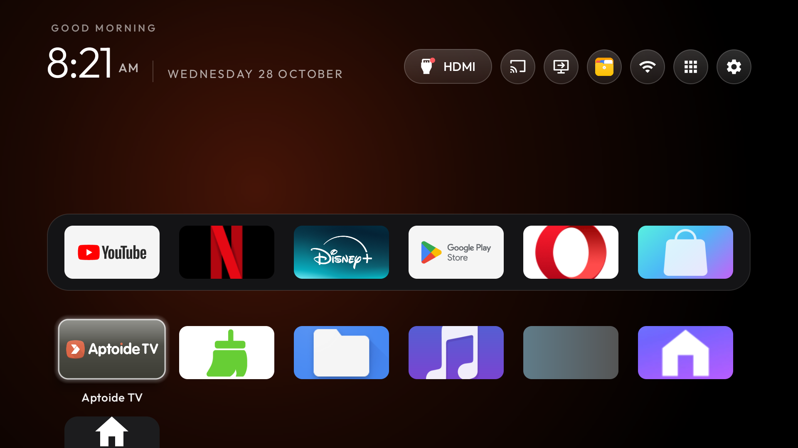

# CleanYourTV for Magcubic HY320 Pro

An unofficial device-specific fork of [Gathin23/CleanYourTV](https://github.com/Gathin23/cleanyourtv).
Apple TV inspired Home with six dock slots, black background, expanding shortcuts, edge-to-edge app
artwork and two editions. No root, firmware flashing or system-partition changes.

| | Basic | Advanced |
|---|---|---|
| Restyled Home, dock, app library and animations | Yes | Yes |
| HDMI status, casting and USB shortcuts | Yes, where supported | Yes, where supported |
| Main Settings button | Manufacturer Settings | Integrated eight-section Settings |
| Appearance configuration | Hold Settings, choose Launcher settings | Other settings, Launcher appearance |
| Integrated projection, audio, Bluetooth, network, language and time controls | No | Yes, subject to firmware authority |
| Privileged settings grants or shell helper | None required | Explicit documented setup |
| Optional local helper startup after reboot | No | Separate Settings Starter app |
| Launcher INTERNET permission | None | None |

**Start with Basic if you only want the Home design.** Advanced is for owners who want integrated
controls and understand the permission/helper setup. Neither edition disables or uninstalls system apps.
The stock launcher must remain installed and enabled.

Original on-device capture, before public edition packaging. Installed-app artwork belongs to its respective owners.

## Compatibility

Tested on **Magcubic HY320 Pro**, Android 14 / SDK 34, firmware
`Projector_20260713.153921`, device `rk3566_rgo`, board `exdroid`, 32-bit ARM userland.
The retail model name alone is insufficient. HY320, HY320 Mini, HY300 and HY300 Pro are not established
compatible. Advanced refuses integrated controls on an unrecognised firmware/device/board.
See [compatibility and verification](docs/hy320pro/COMPATIBILITY.md).

The original Advanced implementation was verified on one physical unit, including optical adjustments
and helper startup after reboot with Wireless debugging off. The new public edition split and signing
configuration have build/static checks; they have not yet been installed on a second unit or physically
retested as public release builds. See the release validation report for exact checks.

## Get started

1. Read [installation](docs/hy320pro/INSTALL.md), select an edition and verify your device.
2. [Build from source](docs/hy320pro/BUILD.md), or inspect the matching source tag and release APK hashes.
3. Back up your own unit, install manually first, then select Home separately.
4. Advanced only: choose the [permissions and helper setup](docs/hy320pro/PERMISSIONS.md).
5. Keep [recovery instructions](docs/hy320pro/RESTORE.md) and your private backup off the projector.

Downloadable APKs belong in this fork's GitHub Releases, never the source tree. They contain no streaming
subscriptions, Google services, AirScreen, third-party app APKs, personal accounts or copied calibration.
Installed applications supply their own icons. Streaming/casting applications must be installed separately.
The ChromeCast shortcut opens AirScreen; this is not certified Chromecast built-in.

## Design and configuration

Defaults: six columns, black background, a time-of-day greeting, the system clock format and a dock of
YouTube, Netflix, Disney+, Play Store, Opera and App Store **only where those packages are installed**.
No app is installed automatically. Missing dock apps follow the existing launcher fill behavior.
Use the launcher appearance page or supported [configuration options](themes/README.md); hold OK to
reorder apps. Artwork fills tiles with cropping. Network name display is optional and needs location
access on Android 14; a generic Network label works without it.

Each user aligns their own projector. Never import another person's corner positions, zoom, orientation,
wall presets, Wi-Fi credentials, accounts, ADB keys or backups.

## Privacy and authority

No analytics or telemetry were added. Advanced uses only fixed typed settings operations; it is not a
generic root/shell terminal. The optional companion has INTERNET permission for a client connection to
`127.0.0.1` using normal paired TLS ADB. It creates its own non-exportable AndroidKeyStore identity.
With the selected optional startup mode, it briefly enables paired Wireless debugging at boot,
confirms the helper and switches debugging off. That temporary interval exposes Android's authenticated
ADB listener to the network; no authentication/expiry controls are disabled. Pairing can expire or be
revoked. [Full permissions and lifecycle](docs/hy320pro/PERMISSIONS.md).

## Contributing and attribution

Changes in this fork are maintained here, not by upstream CleanYourTV. Report the edition, Android SDK
and firmware build, omit identifiers/accounts/network names, and explain what actually happened.
Keep manufacturer package protection and per-device backups. Do not remove firmware guards to claim
support for another board.

Upstream launcher/tools: [MIT](LICENSE). Font licence: [Outfit OFL](launcher/FONT-LICENSE-OFL.txt).
Pairing transport adapts Shizuku (Apache 2.0); pinned BoringSSL/Conscrypt dependencies and their licences
are in [settings-starter/licenses](settings-starter/licenses). No manufacturer binaries are redistributed.
Original project documentation remains in [README.upstream.md](README.upstream.md).
